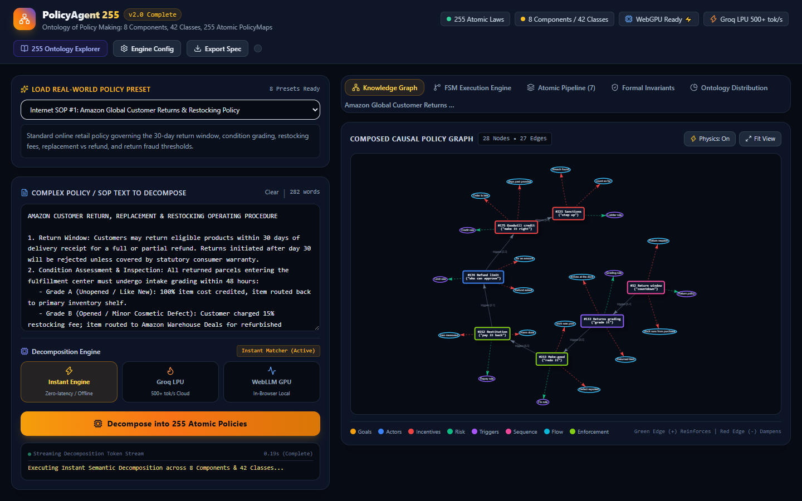
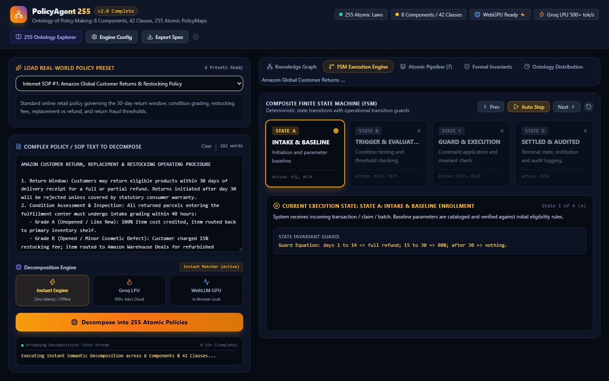
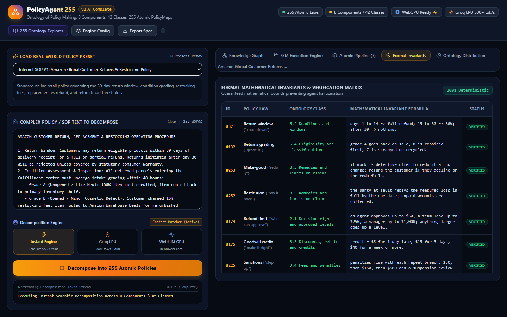
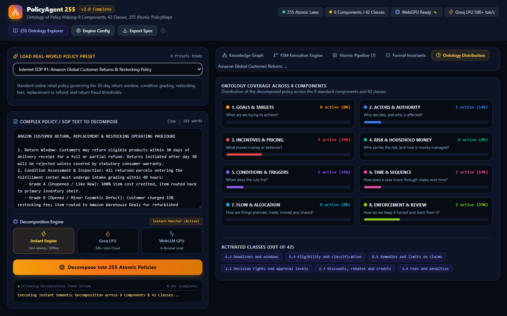

# AtomicSOP: Neural Policy Decomposer & Ontology-Driven State-Space Compiler

> **Decompose complex, messy, ambiguous real-world policies and SOPs from across the Internet into provable invariant compositions of the 255 Atomic Policies across the 8-Component Policy Making Ontology.**

[](https://cosmosanalytics.github.io/AtomicSOP/)
[]()
[]()
[]()
[]()

---

## 🌐 Live Application & GitHub Pages Setup

The application is deployed directly via **GitHub Pages** from the root `index.html` file in this repository:
👉 **[https://cosmosanalytics.github.io/AtomicSOP/](https://cosmosanalytics.github.io/AtomicSOP/)**

> [!IMPORTANT]
> **If you see a `404 - There isn't a GitHub Pages site here`:**
> 1. In this GitHub repository, navigate to **Settings** > **Pages** (in the left sidebar).
> 2. Under **Build and deployment** > **Source**, choose **Deploy from a branch**.
> 3. Under **Branch**, select `main` and folder `/ (root)`, then click **Save**.
> 4. GitHub will deploy the site in 30–60 seconds at `https://cosmosanalytics.github.io/AtomicSOP/`.
> *(Note: The URL must include `/AtomicSOP/`; visiting `cosmosanalytics.github.io` without the repository name returns a 404).*

---

## 💡 Overview

Enterprises and regulatory institutions operate on complex, dense policies: aviation rest protocols, data privacy mandates, hospital triage guidelines, financial reserve limits, and state-space supply chain planning models. In traditional engineering, these procedures are either buried in static manuals or brittle custom code.

**AtomicSOP** treats every complex real-world policy as a mathematical composition of discrete, bounded **atomic policy laws** defined in the **Ontology of Policy Making**.

```
Complex Real-World SOP ──► [WebLLM / Groq Decomposer] ──► Sub-Graph Composition ──► Executable FSM + Invariants
```

### Key Capabilities:
1. **Full 255-Policy Ontology Database**: All 255 policies across the 8 core components and 42 classes (from *Goals & Targets* to *Enforcement & Review*), complete with:
   - "In a Nutshell" operational definitions
   - Governing mathematical invariant equations ($P_{floor} \ge P^*$, $\sum Duty \le 60$, etc.)
   - 4-State Discrete Finite State Machines ($A \rightarrow B \rightarrow C \rightarrow D$)
   - Causal feedback graphs with positive ($+$) and negative ($-$) relations
   - "Spot It in the Wild" real-world applications & one-line takeaways
2. **Three Flexible AI Engines**:
   - 🌐 **WebLLM / WebGPU**: 100% private, zero-backend, client-side neural decomposition in Chrome/Edge using `@mlc-ai/web-llm` (`Qwen2.5-1.5B`, `Llama-3.2-1B`, etc.).
   - ⚡ **Groq LPU**: Ultra-fast cloud inference at 500+ tokens/sec using `llama-3.3-70b-versatile` or `llama-3.1-8b-instant`.
   - 🎯 **Instant Deterministic Engine**: Instant semantic trace matcher with zero latency and offline availability.
3. **8 Built-in Real-World Internet Presets**:
   - **Amazon Returns**: 30-day window, restocking deductions, proof of purchase, exception triage.
   - **EU GDPR Article 17**: Right to erasure, verification grace periods, downstream notification cascade.
   - **FAA FAR Part 117**: Flight duty limits, circadian rest periods, cumulative flight hour caps.
   - **Hospital EMTALA Triage**: Emergency medical screening, stabilization mandate, transfer authorization.
   - **Enterprise Cloud Procurement**: Dual authorization thresholds, spend caps, segregation of duties.
   - **California Tenant Protection (AB 1482)**: 5% + CPI rent increase limits, just-cause eviction notices.
   - **Dr. Zhaoyang Wan's S&OP State-Space World Model**: Dual-pipeline fully-observed inventory balancing.
   - **Federal Reserve Reg D & E**: Electronic transfer caps, 60-day fraud liability, provisional credit.
4. **Visual & Formal Verification**:
   - Interactive **Vis.js Knowledge Graph** showing policy-to-entity causal relationships.
   - Steppable **Discrete 4-State FSM** with transition triggers and guard validations.
   - **Mathematical Invariant Audit Matrix** checking boundary bounds.
   - Interactive **Ontology Catalog Modal** with real-time keyword search and component filtering.

---


---

## 📜 Declarative SOPs: Constraining Action Spaces with Machine-Readable Runbooks

> **"Constrain action spaces with machine-readable runbooks (YAML/JSON schemas) rather than raw open prompts."**

Traditional agentic workflows rely on open-ended prose prompts, which suffer from **stochastic drift, parameter hallucinations, and bypassed authorization gates**. 

AtomicSOP introduces **Declarative SOP Runbooks**:
1. **Explicit Action Space Enumeration**:
   Agents are strictly restricted to an allowed list of tool calls (`allowed_tools`) derived from the 255 atomic policy definitions. Unregistered tool invocations or arbitrary code execution calls are rejected at schema validation time.
2. **Machine-Readable Contracts (YAML & JSON Schema Draft 2020-12)**:
   Every parameter domain (`minimum`, `maximum`, `enum`, `required`), precondition check, and postcondition proof is formally defined for seamless integration with **OpenAI Function Calling**, **Claude Tool Use**, and the **Model Context Protocol (MCP)**.
3. **Hard Mathematical Invariant Bounds**:
   Operational policies enforce non-negotiable inequalities ($P_{floor} \ge P^*$, $\sum Duty \le 60$, $T_{excursion} \le 15\text{m}$) directly in the agent's parameter validation layer.
4. **Interactive Action Space Validator Bench**:
   Includes an in-browser playground to inject compliant or adversarial payloads and test real-time gate responses (`ACTION PERMITTED`, `INVARIANT BREACH`, or `ACTION BLOCKED`).

## 🏛️ The 8-Component Policy Making Ontology

| Component | Class Count | Policy Range | Core Operational Focus |
| :--- | :---: | :---: | :--- |
| **1. Goals & Targets** | 4 classes | Policies #1 – #28 | Floors, ceilings, quotas, milestones, output constraints |
| **2. Actors & Authority** | 6 classes | Policies #29 – #58 | Delegation, segregation of duties, vetoes, escalation, approvals |
| **3. Incentives & Pricing** | 7 classes | Policies #59 – #98 | Subsidies, penalties, dynamic fees, tiered rates, rebates |
| **4. Risk & Household Money**| 4 classes | Policies #99 – #136 | Collateral, reserve buffers, indemnification, capital adequacy |
| **5. Conditions & Triggers** | 5 classes | Policies #137 – #161| Threshold trips, circuit breakers, emergency overrides, triggers |
| **6. Time & Sequence** | 6 classes | Policies #162 – #193| Grace periods, expirations, cool-downs, prerequisite DAG order |
| **7. Flow & Allocation** | 5 classes | Policies #194 – #228| FIFO queues, quota rationing, bottlenecks, routing priority |
| **8. Enforcement & Review** | 5 classes | Policies #229 – #255| Audits, dispute arbitration, clawbacks, compliance verification |

---

## 📸 Screenshots

| Composite Knowledge Graph | Steppable 4-State Machine |
| :---: | :---: |
|  |  |

| Invariant Audit Matrix | 255-Policy Ontology Catalog |
| :---: | :---: |
|  |  |

---

## 🚀 Getting Started

### Option 1: Live in Browser
Open **[https://cosmosanalytics.github.io/AtomicSOP/](https://cosmosanalytics.github.io/AtomicSOP/)** in any modern web browser (Chrome, Edge, Brave, Firefox, Safari).

### Option 2: Run Locally (Zero Server Required)
Simply clone the repo and open `index.html` directly in your browser:
```bash
git clone https://github.com/cosmosanalytics/AtomicSOP.git
cd AtomicSOP
start index.html   # On Windows
open index.html    # On macOS
xdg-open index.html # On Linux
```

---

## 📄 License & Attribution

- Built as part of the **AI Engineering State-Space Systems & PolicyMap Research**.
- Features the **8-Component Ontology of Policy Making** and the **255 Atomic Policy Archetypes**.
- Includes client-side neural acceleration powered by **WebLLM (@mlc-ai)** and **Groq LPU**.
