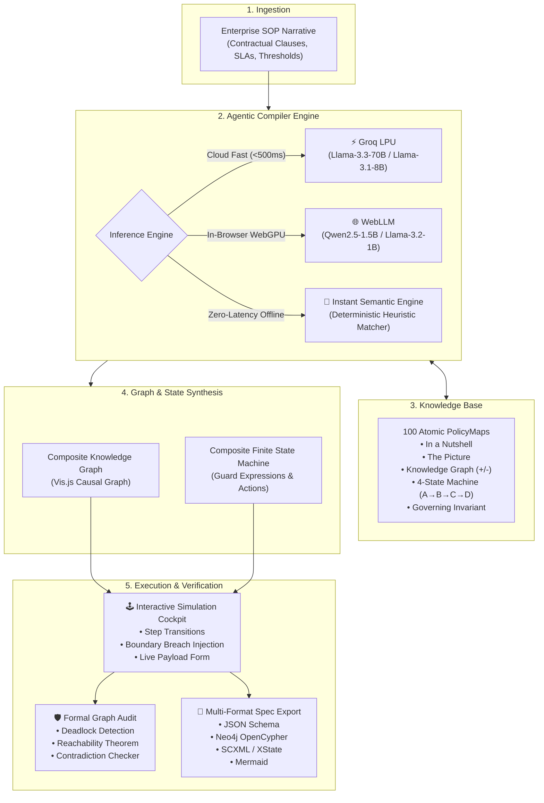
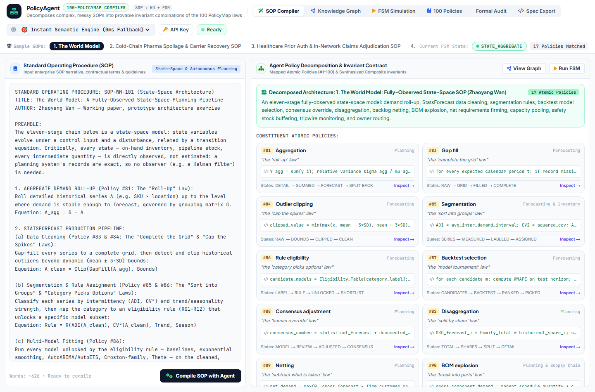
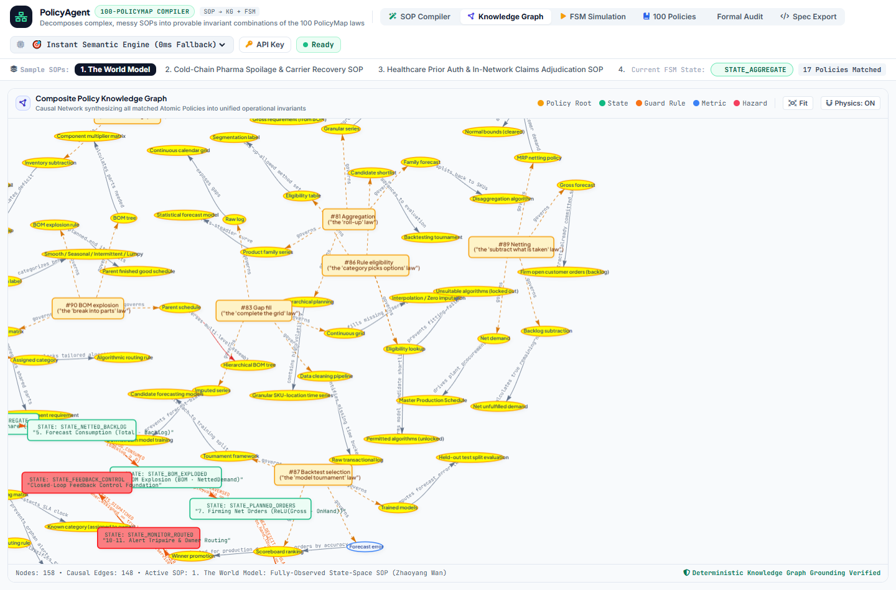
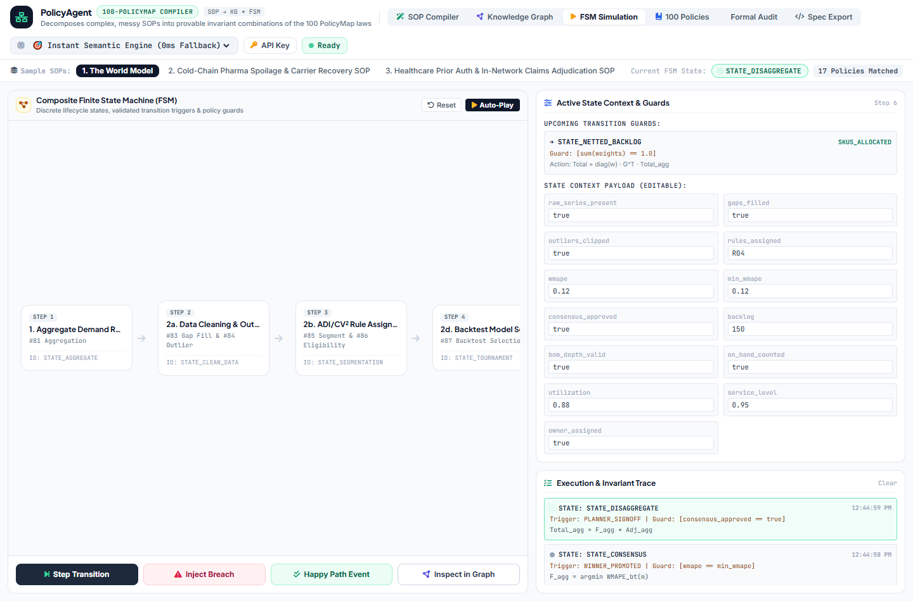
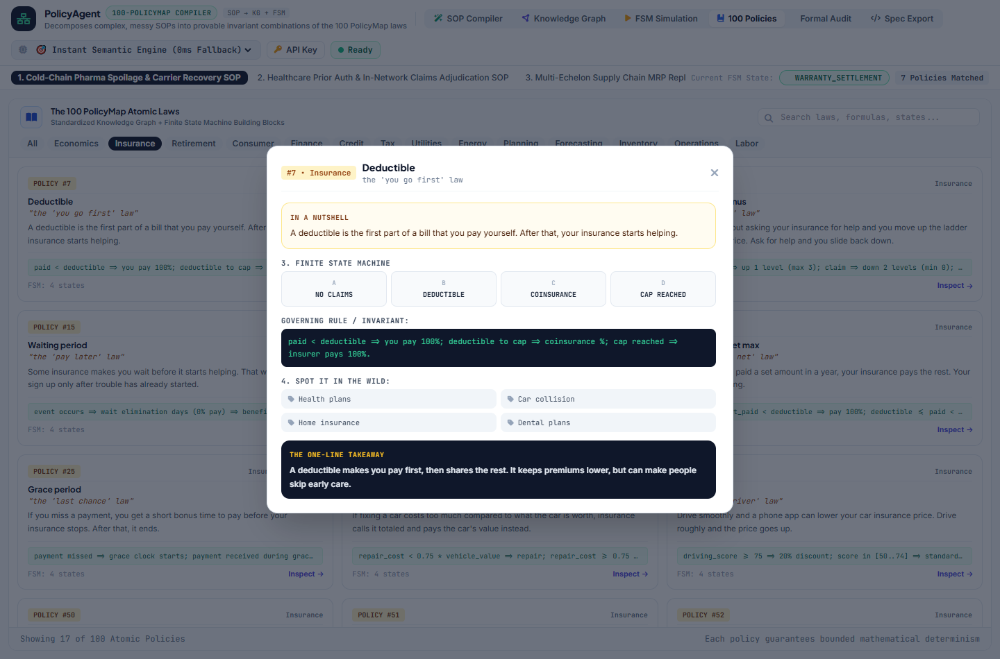
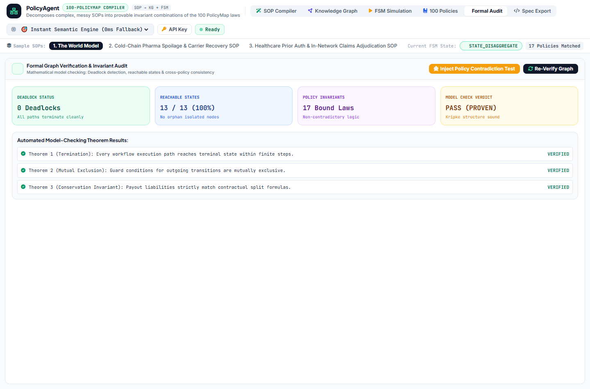
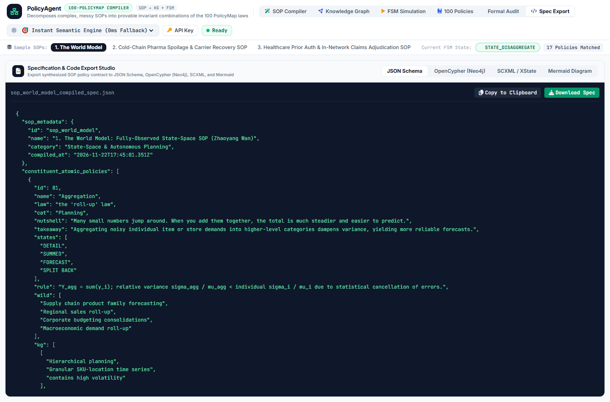

# AtomicSOP: SOP-to-PolicyMap Knowledge Graph & Finite State Machine Compiler

> **Decomposing complex, messy, ambiguous Standard Operating Procedures (SOPs) into provable invariant combinations of the 100 PolicyMap atomic laws.**

[](https://cosmosanalytics.github.io/AtomicSOP/)
[]()
[]()
[]()

---

## 💡 Overview

Enterprises are built on complex Standard Operating Procedures (SOPs) that govern clinical triage, cold-chain logistics, material requirements planning (MRP), energy dispatch, and consumer warranties. In traditional systems, these SOPs are either buried in static PDF manuals or hardcoded in brittle application scripts.

**AtomicSOP** treats enterprise SOPs as compositions of discrete, reusable, mathematically bounded **atomic policy laws** (from the **100 PolicyMap** catalog). It acts as an autonomous compilation agent that:
1. **Decomposes** unstructured SOP narratives into constituent atomic policy laws.
2. **Synthesizes a Composite Knowledge Graph** mapping causal drivers, positive ($+$) and negative ($-$) feedback loops, and governing invariant rules.
3. **Generates an Executable Composite Finite State Machine (FSM)** with discrete lifecycle states, transition triggers, guard expressions, and operational actions.
4. **Executes Interactive In-Browser Simulation** enabling step-by-step verification, live payload inspection, and boundary breach injections.
5. **Formally Audits** the composite model for terminal reachability, deadlock freedom, and invariant contradictions.
6. **Exports Production Specifications** to **JSON Schema**, **OpenCypher (Neo4j)**, **SCXML / XState**, and **Mermaid diagrams**.

---

## 🏛️ System Architecture



---

## 📋 Preloaded Enterprise Sample SOPs

### 1. The World Model: Fully-Observed State-Space Planning (Zhaoyang Wan)
*Featured premier SOP based on the eleven-stage state-space architecture paper.*
* **Equations & Stages**:
  * **Aggregate**: $A_{agg} = G \cdot A$ (*Policy #81 The "Roll-Up" Law*)
  * **Data Cleaning**: $A_{clean} = \text{Clip}(\text{GapFill}(A_{agg}), \text{Bounds})$ (*Policy #83 Gap Fill & #84 Outlier Clipping*)
  * **Segmentation & Rules**: $\text{Rule} = R(\text{ADI}, \text{CV}^2, \text{Trend}, \text{Season})$ (*Policy #85 Segmentation & #86 Rule Eligibility*)
  * **Model Tournament**: $F_{agg} = F_{m^*}, m^* = \arg\min_m \text{WMAPE}_{bt}(m)$ (*Policy #87 Backtest Selection*)
  * **Consensus**: $\text{Total}_{agg} = F_{agg} + \text{Adj}_{agg}$ (*Policy #88 Consensus Adjustment*)
  * **Disaggregate**: $\text{Total} = \text{diag}(w) \cdot G^T \cdot \text{Total}_{agg}$ (*Policy #82 Disaggregation*)
  * **Netting**: $\text{NettedDemand} = \text{Total} - \text{Backlog}$ (*Policy #89 Netting*)
  * **Dependent Demand**: $\text{GrossReq} = \text{BOM} \cdot \text{NettedDemand}$ (*Policy #90 BOM Explosion*)
  * **Firming**: $\text{PlannedOrder} = \text{ReLU}(\text{GrossReq} - \text{OnHand})$ (*Policy #91 Net Requirements*)
  * **Capacity Check**: $\text{Utilization} = \text{Load} / \text{Capacity}$ (*Policy #92 Capacity Check*)
  * **Buffer Sizing**: $\text{SafetyStock} = \text{diag}(\text{SLF}) \cdot \text{GrossReq}$ (*Policy #93 Safety Stock & #99 SLA Target*)
  * **Tripwire Monitor & Routing**: $\text{Alert} = 1[\text{condition}], \text{Owner} = \text{AlertFired} \cdot \text{OwnerMap}$ (*Policy #94 & #95*)
  * **Closed-Loop Foundation**: Deterministic consequence engine for feedback control (*Policy #100*).

### 2. Cold-Chain Pharma Spoilage & Carrier Recovery SOP
* **Constituent Policies**: **#94 Threshold alert** (IoT temp $>8^\circ\text{C}$ for 60 min) + **#95 Owner routing** (quarantine dispatch) + **#50 Replacement cost** (valuation) + **#20 Warranty** (minor loss $\le \$5\text{k}$) + **#7 Deductible** (carrier primary insurance) + **#51 Subrogation** (pursuit of 3rd-party refrigeration contractor) + **#30 Lemon law** (3-strikes vendor disqualification).

### 3. Healthcare Inpatient Prior Auth & Out-of-Pocket Claims Adjudication SOP
* **Constituent Policies**: **#53 Prior authorization** + **#52 In-network fence** + **#7 Deductible** + **#12 Copay vs coinsurance** + **#22 Out-of-pocket max** + **#79 Risk pooling**.

### 4. Autonomous Multi-Echelon Supply Chain MRP Replenishment SOP
* **Constituent Policies**: **#89 Netting** + **#90 BOM explosion** + **#91 Net requirements** + **#93 Safety stock** + **#96 Reorder point** + **#97 Lot sizing** + **#98 Lead time offset**.

### 5. E-Commerce Multi-Tier Returns, Price Match & Loyalty SOP
* **Constituent Policies**: **#32 Return window** (14/30 day countdown) + **#33 Price match** + **#43 BOGO** + **#74 Mail-in rebate** + **#80 Cooling-off period** + **#75 Points expiry**.

### 6. Fintech Credit Card Grace Period, Revolving APR & Teaser Transfer SOP
* **Constituent Policies**: **#25 Grace period** + **#18 Minimum payment** + **#62 Compound interest** + **#41 Late fee** + **#69 Balance transfer** + **#100 Feedback control**.

### 7. Smart Grid Dynamic Time-of-Use & Solar Net Metering SOP
* **Constituent Policies**: **#36 Time-of-use** + **#73 Net metering** + **#72 Inclining block rates** + **#92 Capacity check** + **#94 Threshold alert** + **#100 Feedback control**.

---

## 📸 Screenshots

| View | Screenshot |
| :--- | :--- |
| **SOP Compiler Studio** |  |
| **Composite Knowledge Graph** |  |
| **FSM Simulation Cockpit** |  |
| **100 Policies Catalog & Modal** |  |
| **Formal Invariant Audit** |  |
| **Specification & Code Export** |  |

---

## ⚡ Execution Engines

1. **Instant Semantic Engine (Default)**:
   * 0ms latency, zero external API keys, zero downloads.
   * Runs locally in any web browser.
2. **Groq LPU (Llama 3.3 70B Versatile)**:
   * Fast cloud compilation (<500ms).
   * Enter your Groq API key via the **API Key** button in the top navigation bar. Key is stored locally in your browser (`localStorage`).
3. **WebLLM WebGPU**:
   * Client-side private LLM execution powered by `@mlc-ai/web-llm`.
   * Automatically detects `navigator.gpu` and streams weights directly to browser memory.

---

## 🚀 Quick Start

### Running Locally
No build step or Node.js environment required:
1. Clone the repository:
   ```bash
   git clone git@github.com:cosmosanalytics/AtomicSOP.git
   cd AtomicSOP
   ```
2. Open `index.html` in Chrome, Edge, Safari, or Firefox:
   ```bash
   # On Windows
   start index.html

   # On macOS
   open index.html

   # On Linux
   xdg-open index.html
   ```

### Deploying to GitHub Pages
1. Go to repository **Settings** &rarr; **Pages**.
2. Under **Build and deployment**, set Source to **Deploy from a branch** (`main` / root `/`).
3. Your live application will be available at `https://cosmosanalytics.github.io/AtomicSOP/`.

---

## 📄 License

MIT License. Open source and free for enterprise engineering, research, and educational modeling.
